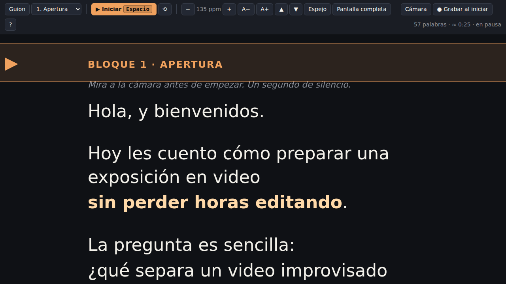
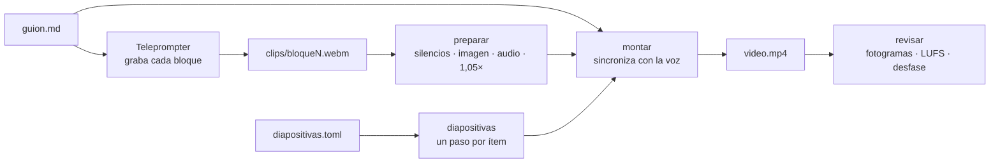
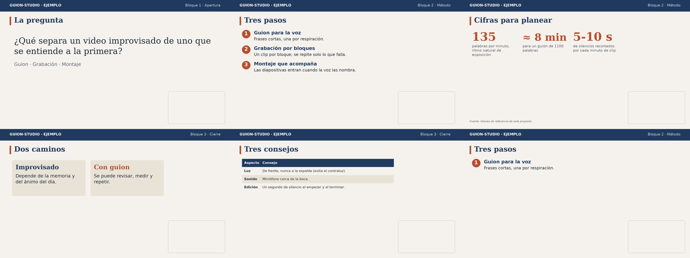

# guion-studio

**Del guion al video:** un teleprompter web que graba cada bloque con la cámara y una herramienta de línea de comandos que recorta silencios, mejora imagen y sonido, genera diapositivas animadas sincronizadas con la voz y monta el video final con FFmpeg.

[](https://github.com/Natalia001-bz/guion-studio/actions/workflows/pruebas.yml)
**Demo del teleprompter:** <https://natalia001-bz.github.io/guion-studio/>

> **In English.** guion-studio turns a Markdown script into a finished presentation video. A browser teleprompter reads the script at a set words-per-minute pace and records each block with the webcam (nothing leaves the browser). A Python CLI then trims silences, applies a gentle image and audio cleanup, speeds speech up slightly (1.05×) without changing the pitch, renders slides from TOML data, reveals each bullet with a fade when the speaker says it, and assembles everything with the camera in the corner using FFmpeg. It was built and tested while producing a real 9-minute university video. The documentation is in Spanish.



## Por qué existe

Grabar una exposición en video suele costar más en edición que en preparación: silencios al inicio y al final de cada toma, pausas largas, una cara oscura por el contraluz, el volumen bajo y diapositivas que no coinciden con lo que se dice. Esta herramienta nació al producir un video universitario de 9 minutos y recoge lo que funcionó y también lo que salió mal:

| Problema real | Cómo lo resuelve |
|---|---|
| Leer el guion sin que se note | Teleprompter con franja de lectura bajo la cámara, ritmo en palabras por minuto y líneas cortadas por respiración |
| Clips con nombres desordenados | El teleprompter graba y descarga cada bloque como `bloque1.webm`, `bloque2.webm`… |
| Silencio al empezar y al detener la grabación | Se detecta con FFmpeg y se corta, dejando un margen natural |
| Video demasiado largo | Las pausas mayores de 0,7 s quedan en 0,35 s y la voz se acelera a 1,05× sin cambiar el tono |
| Cara oscura por el contraluz | Corrección suave de tonos medios (las correcciones fuertes se veían artificiales) |
| Voz "metálica" | Sin reducción de ruido cuando la grabación ya es limpia; normalización a −16 LUFS |
| Diapositivas que no coinciden con la voz | Cada ítem tiene la frase del guion que lo hace aparecer; el tiempo se ajusta al inicio de frase más cercano en el audio |
| FFmpeg sin memoria al montar | La pista de diapositivas se arma tramo por tramo, con dos imágenes en memoria por vez |

## Cómo funciona





## Instalación

Requisitos: Python 3.11 o superior y FFmpeg (con `rubberband`, que viene en los paquetes de Ubuntu, Debian y Homebrew).

```bash
sudo apt install ffmpeg            # Ubuntu / WSL
git clone https://github.com/Natalia001-bz/guion-studio.git
cd guion-studio
python3 -m venv .venv && source .venv/bin/activate
pip install -e .
```

El teleprompter no necesita instalación: se abre `teleprompter/index.html` con doble clic o se usa la [demo en línea](https://natalia001-bz.github.io/guion-studio/).

## Uso rápido

```bash
guion-studio iniciar mi-video        # crea el proyecto con un ejemplo completo
cd mi-video
guion-studio guion                   # duración estimada y frases de las diapositivas
```

1. Escribe `guion.md` y ábrelo en el teleprompter (botón **Guion** o arrastrando el archivo).
2. Activa **Grabar al iniciar** y graba cada bloque; guarda los archivos en `clips/`.
3. Describe las diapositivas en `diapositivas.toml`.
4. Prepara, revisa el plan y monta:

```bash
guion-studio preparar --plan         # muestra los cortes sin procesar
guion-studio preparar                # clips listos en preparados/
guion-studio plan                    # segundo en que entra cada diapositiva e ítem
guion-studio montar --limite 10      # video final + hoja de fotogramas + informe
```

Si una diapositiva o un ítem queda corrido, se corrige en `ajustes.toml` y se vuelve a montar:

```toml
[tiempos]
"cifras" = 24.0      # segundo del bloque en que entra la diapositiva
"cifras#2" = 31.5    # segundo en que aparece su segundo ítem
```

## Documentación

- [Formato del guion](docs/formato-guion.md): bloques, respiraciones, pausas, énfasis y pronunciación.
- [Diapositivas](docs/diapositivas.md): los nueve tipos, cómo se animan y cómo se sincronizan.
- [Configuración](docs/configuracion.md): todas las opciones de `proyecto.toml`.
- [Decisiones técnicas](docs/decisiones.md): por qué FFmpeg directo y no Remotion ni skills de terceros, y las lecciones de uso real.
- [Mapa del repositorio](MAPA.md).

## Pruebas

```bash
pip install -e ".[dev]"
pytest                       # 15 pruebas; las de extremo a extremo generan clips sintéticos con FFmpeg
pytest -m "not lento"        # solo las rápidas
node --test tests/           # lector del guion del teleprompter
```

La integración continua ejecuta las dos suites en cada cambio y publica el teleprompter en GitHub Pages.

## Privacidad

El teleprompter funciona por completo en el navegador: el guion y los videos no se envían a ningún servidor. La herramienta de línea de comandos trabaja solo con archivos locales.

## Licencia y autoría

MIT © 2026 Natalia Berrio Zuleta. Desarrollado con asistencia de Claude Code (Anthropic) como apoyo de programación; las decisiones de diseño y el uso real que lo originó son propios.
